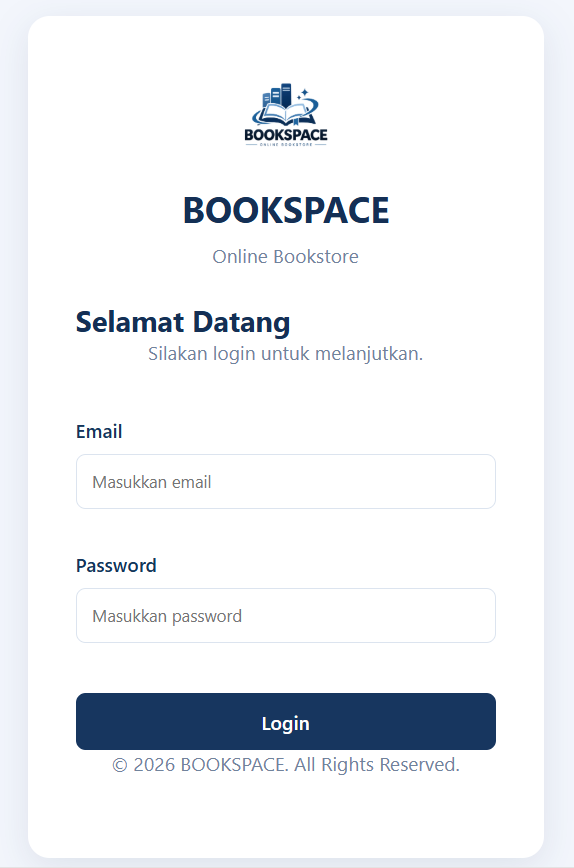
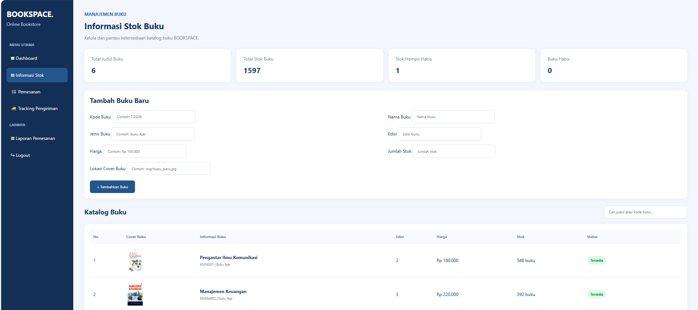
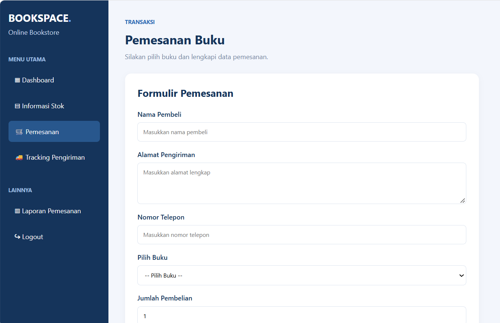
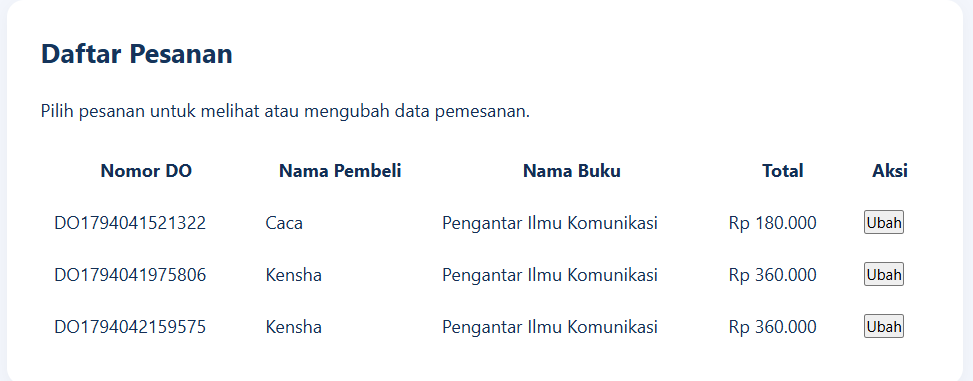
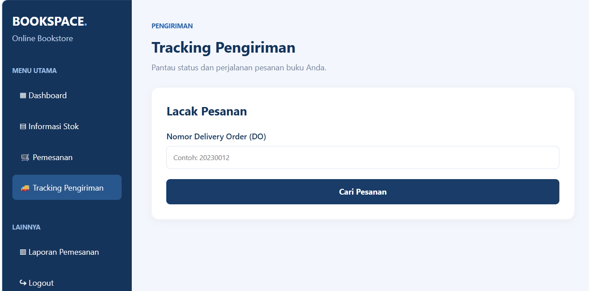

# BOOKSPACE – Online Bookstore

## 1. Informasi Proyek

**Nama Proyek:** BOOKSPACE – Online Bookstore  
**Jenis Proyek:** Website Toko Buku Online  
**Mata Kuliah:** Pemrograman Web  
**Tujuan:** Membuat website toko buku sederhana untuk mengelola katalog buku, stok, pemesanan, dan informasi pengiriman.

## 2. Deskripsi Proyek

BOOKSPACE merupakan website toko buku online yang dirancang untuk membantu pengguna melihat katalog buku, melakukan pemesanan, serta memantau informasi pengiriman.

Website ini dibuat menggunakan HTML, CSS, dan JavaScript. Data katalog dan transaksi dikelola menggunakan JavaScript serta penyimpanan localStorage pada browser.

## 3. Fitur Website

1. **Login:** Pengguna dapat masuk menggunakan akun yang tersedia.
2. **Dashboard:** Menampilkan ringkasan informasi buku, pesanan, stok, dan pendapatan.
3. **Informasi Stok:** Menampilkan katalog buku dan informasi ketersediaan stok serta fitur penambahan buku.
4. **Pemesanan:** Pengguna dapat mengisi informasi pembeli, memilih buku, menghitung total pembayaran, dan mengelola pesanan.
5. **Tracking Pengiriman:** Menampilkan informasi pesanan berdasarkan Nomor Delivery Order (DO).

## 4. Teknologi yang Digunakan

- HTML
- CSS
- JavaScript
- DOM Manipulation
- LocalStorage
- Visual Studio Code
- Live Server

## 5. Struktur Folder

```text
tugas-uts-web1/
├── index.html
├── dashboard.html
├── stok.html
├── tracking.html
├── checkout.html
├── README.md
├── css/
│   └── style.css
├── js/
│   ├── script.js
│   └── data.js
├── assets/
│   └── logo.png
└── img/
    ├── kepemimpinan.jpg
    ├── manajemen_keuangan.jpg
    ├── mikrobiologi.jpg
    ├── paud_perkembangan.jpg
    └── pengantar_komunikasi.jpg
```

## 6. Dokumentasi Screenshot

Berikut dokumentasi hasil pengerjaan dan tampilan website BOOKSPACE:

### 1. Halaman Login


### 2. Dashboard


### 3. Informasi Stok


### 4. Pemesanan


### 5. Daftar Pesanan


### 6. Tracking Pengiriman


## 7. Video Penjelasan Proyek

Link YouTube: **(Tambahkan link video setelah video diunggah)**

## 8. Repository GitHub

Link Repository: **(Tambahkan link repository setelah proyek diunggah ke GitHub)**
